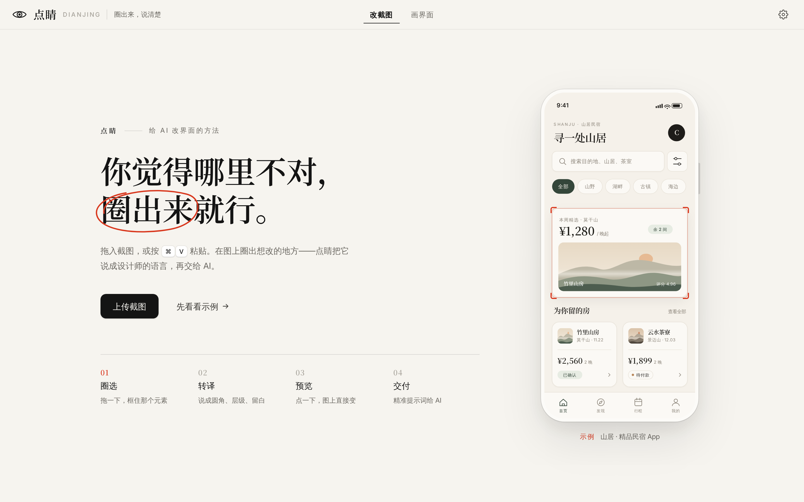
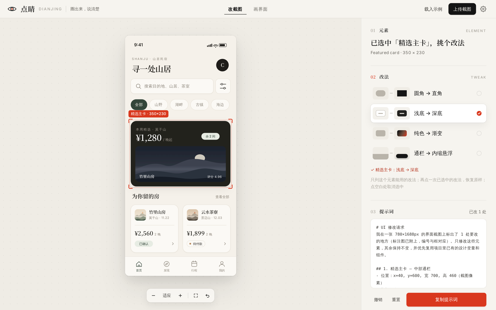
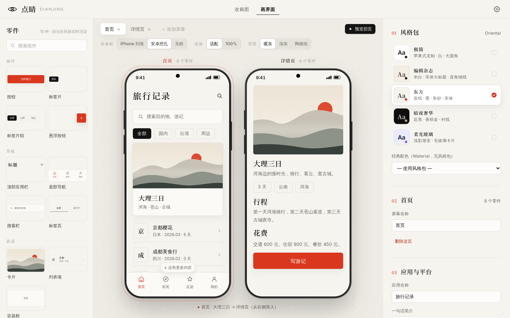
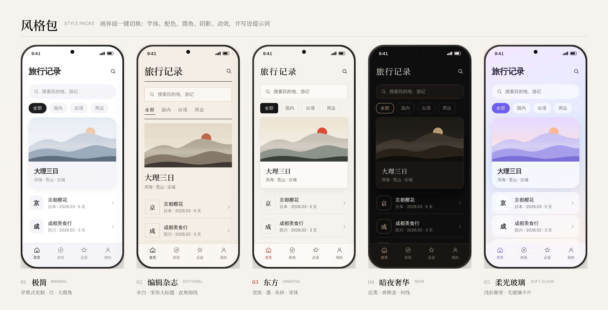
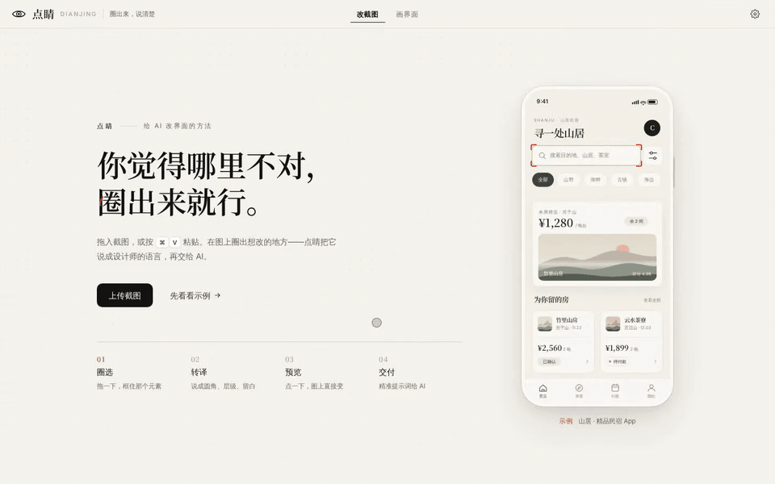

<div align="center">


# Dianjing 点睛

**Circle it. Say it right.**

AI-generated UIs are always almost right. Drop in a screenshot, circle what feels off,<br/>
and Dianjing turns that feeling into design language, shows you the change before you make it,<br/>
then hands Cursor, Claude Code, Trae or Lovable a prompt they get on the first try.

[**Try it online →**](https://ttnan.github.io/dianjing/) &nbsp;·&nbsp; [中文](README.md) &nbsp;·&nbsp; MIT &nbsp;·&nbsp; zero build, pure front end

<br/>



</div>

---

## The name

**画龙点睛**, "dotting the dragon's eye": a painted dragon only comes alive with the final stroke on its eyes.

AI-written interfaces get you 80% of the way. The last 20% is a corner radius, a shadow, a bit of whitespace. You can see it's wrong but can't say why. Dianjing helps you land that last stroke.

## Two modes

### 1 · Annotate: circle it, say it right



- **Circle**: upload, drag in or ⌘/Ctrl + V any screenshot (web, Android, iOS, mini-programs, design files) and drag a box around what you want changed. Move, resize, nudge with arrow keys, Ctrl/⌘ + wheel to zoom.
- **Translate**: one-line directions ("more premium", "too busy") plus a 27-term design vocabulary in 7 groups (spacing, hierarchy, color, type, finish, layout, style), each with a plain-language hint.
- **At a glance**: 18 before → after thumbnails (round → square, solid → outline, light → dark, full-width → inset floating). Conflicting directions cancel each other.
- **Preview**: on the built-in demo, click an element and only its 2–4 applicable tweaks appear; click one and the picture changes, with undo, reset and compare-to-original. For your own screenshots, an AI model can generate three variants pasted back in place with a wipe slider.
- **Deliver**: copy the prompt in Chinese or English, with coordinates, semantic position, in-box text and a numbered annotated image. Boxes without a direction are left out.

### 2 · Sketch: assemble it, describe it all at once



- **16 parts**: buttons, chips, cards, list items, tab bars and more. Click to add, drag to reorder.
- **Links and tap-through preview**: wire cards and buttons to other screens (7 transitions) and tap through like a real app.
- **Five style packs**: switch the whole aesthetic in one click (type pairing, palette, radius, shadow, motion), and the prompt spells out the exact spec so the AI can actually build it.
- **Platforms and component libraries**: WeChat mini-program, uni-app, Taro, HarmonyOS ArkUI, Flutter; Vant, TDesign, Ant Design Mobile, NutUI. The prompt uses the chosen library's component names.
- **Autosave** in the browser.



| Pack | Feel |
|---|---|
| Minimal | Apple-like restraint · white · large radius · light shadow |
| Editorial | Off-white · serif headlines · square corners, hairlines |
| Oriental | Rice paper · ink · vermilion · serif |
| Noir | Near-black · champagne gold · serif |
| Soft Glass | Pastel gradients · frosted cards |

## Demo



[HD mp4](docs/redesign/demo.mp4)

## Why

Plenty of tools help an AI *locate* an element (React Grab, Agentation, stagewise, ComposeBridge…), but they only answer **where**. What stops most people is **what to change it to**: you feel the tab bar looks cheap but can't say "floating capsule, large radius, soft shadow, solid active state".

| | Locator tools | Dianjing |
|---|---|---|
| Tell the AI which element | ✅ | ✅ coordinates + semantic position + numbered image |
| Turn a vague feeling into design terms | ❌ | ✅ vocabulary + AI suggestions |
| Express it without jargon | ❌ | ✅ before → after thumbnails |
| See the result before changing code | ❌ | ✅ click-to-change / three variants in place |
| Needs source code or a framework | Yes | **No**, any screenshot works |

## AI model (optional)

Without a model, everything works except two features: **AI recognition** (identifies the element, points out problems, suggests tweaks) and **three variant previews**. Add any **OpenAI-compatible vision model** to unlock them: OpenAI, Qwen, Zhipu GLM, Gemini, OpenRouter or local Ollama. Your API key stays in your browser and requests go straight to your provider.

## Quick start

Open the **[online demo](https://ttnan.github.io/dianjing/)** and click "先看看示例" (see an example).

Run locally, no build, no dependencies:

```bash
git clone https://github.com/TTNAN/dianjing.git
cd dianjing
python3 -m http.server 8000   # or npx serve
# open http://localhost:8000
```

> ES modules need a local server; don't open `index.html` directly. Deploys as-is to GitHub Pages, Vercel or Netlify.

## Project layout

```
index.html           page shell
favicon.svg          icon
assets/fonts/        font subsets (Noto Serif SC + Inter, SIL OFL)
src/app.js           annotate mode: boxes, inspector, click-to-change, motion
src/demo.js          built-in "Shanju" boutique-stay demo (SVG, redrawable per element)
src/vocab.js         vocabulary + before/after tweaks (best place for PRs)
src/prompt.js        prompt assembly (zh / en)
src/llm.js           OpenAI-compatible client: recognition + variants
src/sketch.js        sketch mode: parts, screens, style packs, prompt
src/styles.css       global look: rice paper · ink · vermilion
src/sketch.css       sketch mode styles
tests/unit.test.mjs  unit tests
tests/e2e.py         Playwright end-to-end tests and recording
```

## Tests

```bash
node --test tests/unit.test.mjs
python3 -m http.server 8766       # from the repo root
python3 tests/e2e.py              # needs playwright + chromium
```

## Roadmap

- [x] Screenshot annotation, vocabulary, before/after tweaks, three variants, prompt output
- [x] Click-to-change demo with per-element tweaks
- [x] Sketch mode with links, tap-through preview, Chinese platforms and component libraries
- [x] v0.6 redesign (rice paper · ink · vermilion) and five style packs
- [ ] Browser extension: annotate any live page, no screenshot needed
- [ ] MCP server so Claude Code / Cursor can read annotations directly
- [ ] Integrate React Grab, Agentation, ComposeBridge for source locations
- [ ] Android via adb screenshots + accessibility tree
- [ ] More style packs; vocabulary for motion, forms, data viz, accessibility

Full history in the [CHANGELOG](CHANGELOG.md).

## Contributing

The most valuable contributions extend `src/vocab.js` (vocabulary terms and before/after tweaks) or add a style pack in `src/sketch.js`. Issues and PRs welcome.

## License

[MIT](LICENSE) © 2026 Caesar T

Sketch mode is adapted from [lnkiai/m3e-canvas](https://github.com/lnkiai/m3e-canvas) (MIT). Fonts: Noto Serif SC and Inter (SIL OFL). See [NOTICE](NOTICE).
