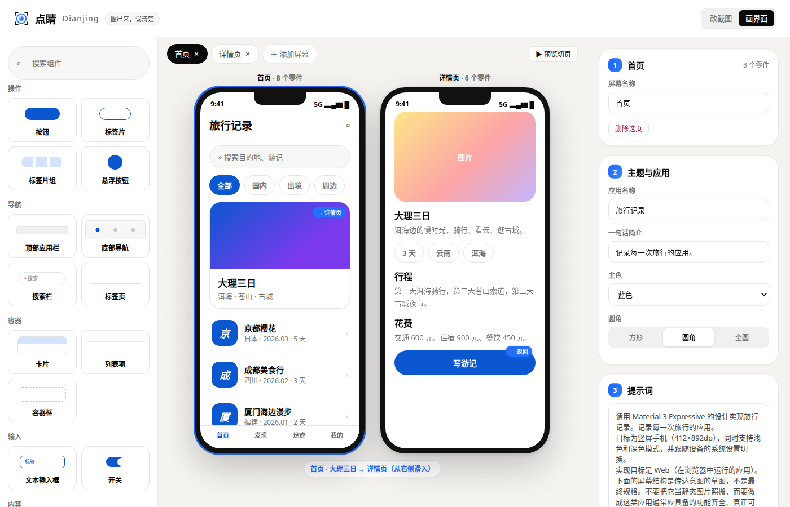

<div align="center">

# ◎ Dianjing 点睛

**Circle it. Say it like a designer.**

Circle what bugs you on any UI screenshot. Dianjing turns the feeling into precise design language, shows visual before → after tweaks and three live previews, then writes a prompt your AI coding tool gets right the first time.

There's a second mode, **画界面 (Sketch screens)**, in the top bar: click parts from a library to assemble an app's screens, link cards to other screens, tap through the flow in a preview player, and get a full Chinese prompt for the whole design — paste it into Claude Code / Codex / Cursor and it generates a runnable app.

[**Live demo**](https://ttnan.github.io/dianjing/) · [中文](README.md) · MIT


🎬 Demo video

https://github.com/user-attachments/assets/1dd060c5-f948-4e76-8a56-a7c16788132e

</div>

---

### The name

*Huà lóng diǎn jīng* (画龙点睛) — "painting the dragon, then dotting its eyes." Legend says the dragon only came alive once its eyes were painted in. AI-generated UIs usually get you 80% of the way; Dianjing helps you land the finishing touch.

### Why

Plenty of tools already help an AI *locate* an element (React Grab, Agentation, stagewise, ComposeBridge…). They answer **where** to change. What actually stops most people is **what** to change it into: you feel the tab bar looks "cheap", but you can't say "floating pill, large radius, soft shadow, filled active state".

| | Element pickers | Dianjing |
|---|---|---|
| Tell the AI which element | ✅ | ✅ Screenshot coordinates, semantic position, numbered annotated image |
| Translate a vague feeling into design terms | ❌ | ✅ Design vocabulary + AI suggestions |
| Express it without knowing the jargon | ❌ | ✅ Visual before → after tweaks |
| Preview before changing anything | ❌ | ✅ Three distinct variations rendered live |
| Needs source code / a specific framework | Yes | **No** — web, Android, iOS, mini-programs or design mockups |

### Features

1. **Circle on a screenshot** — upload, drag in or paste (⌘/Ctrl + V), then drag to mark one or more areas, with live size readout.
2. **One-tap directions** — "More premium", "More compact", "Too messy"… no jargon needed.
3. **Visual tweaks** — 18 tiny before → after illustrations such as rounded → sharp, filled → outline, row → column, full-width → inset floating. Tap one and the exact instruction goes into the prompt.
4. **Design vocabulary** — 27 terms in 7 groups (spacing, hierarchy, color, typography, shape & depth, layout, overall style), each with a plain-language hint.
5. **AI recognition** (optional) — identifies the element ("bottom tab bar"), describes its current style, points out issues and suggests terms.
6. **Three variations** (optional) — generates three visual alternatives that match your intent; pick one to include in the prompt.
7. **Output** — copy the prompt in Chinese or English plus a numbered annotated image, ready for Cursor, Claude Code, Trae, Codex, Lovable, v0, Bolt and more.
8. **Sketch screens (second mode)** — 16 Chinese parts (button, chip, card, list item, bottom navigation…), click to add; edit copy, style and tap targets in the inspector; the preview player plays the tap-through flow with a history stack; the whole design generates a live 10-section Chinese prompt (colors, shape/type/motion, screen structure, behavior & navigation, component styles, principles). 3 palettes × 3 corner styles; autosaved to the browser.



Features 1–4 and 7–8 work fully offline. Add any **OpenAI-compatible vision model** to unlock 5 and 6: OpenAI, Qwen (DashScope), Zhipu GLM, Gemini, OpenRouter or local Ollama. Your API key stays in your own browser, and requests go straight to the provider you choose — no middle server.

### Quick start

Open the **[live demo](https://ttnan.github.io/dianjing/)** and click "先看看示例" (see the example).

Run locally — no build step, no dependencies:

```bash
git clone https://github.com/TTNAN/dianjing.git
cd dianjing
python3 -m http.server 8000   # or: npx serve
# open http://localhost:8000
```

> The app uses ES modules, so serve it over HTTP instead of opening `index.html` directly.

It also deploys as-is to GitHub Pages, Vercel or Netlify.

### What the prompt looks like

```
# UI change request
I marked 1 element(s) on a 780×1688px screenshot (attached as an annotated image; numbers match the boxes). Change ONLY these elements, keep everything else as is, and reuse the project's existing design tokens/components.

## 1. Bottom tab bar — full-width, bottom of the screen
- Box: x=4, y=1532, w=772, h=152 (px on the screenshot)
- Currently: white edge-to-edge bar, gray icons, dark active item
- Desired changes:
  - Layout: turn the edge-to-edge bar into an inset floating bar (16px sides, 12px bottom, large radius, shadow)
  - Make it feel premium: restrained palette (one accent + neutrals), generous whitespace, refined type weights, subtle shadows and radii
- In my words: looks cheap, want it to feel like Apple
- Chosen direction: "Floating pill" — the bar lifts into a pill with a filled active item

Before editing, find the component that renders each element (match by text and position). After editing, briefly list the files you changed.
```

### Project structure

```
index.html        App shell
src/app.js        Selection, rendering, interactions and motion
src/vocab.js      Design vocabulary + visual tweaks (PRs most welcome here)
src/prompt.js     Prompt builder (Chinese / English)
src/llm.js        OpenAI-compatible client: recognition + variations
src/demo.js       Built-in example screen (a travel app)
src/styles.css    UI and animation
tests/e2e.py      Playwright end-to-end test and screen recording (mocked model)
```

### Roadmap

- [x] v0.1 Screenshot circling, design vocabulary, visual tweaks, three variations, prompt output
- [ ] Browser extension: circle directly on any web page, no screenshot needed
- [ ] MCP server so Claude Code / Cursor can read your selections directly
- [ ] Integrate element pickers (React Grab, Agentation, ComposeBridge) to add source locations
- [ ] Android: capture real-device screens and the accessibility tree via adb
- [ ] More vocabulary and visual tweaks: motion, forms, data viz, accessibility
- [ ] Side-by-side and slider comparison of variations

### Contributing

The most valuable contributions extend `src/vocab.js`:

- **Vocabulary terms**: a plain-language `hint` plus precise `prompt.zh` / `prompt.en`
- **Visual tweaks**: `before` / `after` mini HTML illustrations plus a `prompt`

Issues and pull requests are welcome.

### License

[MIT](LICENSE) © 2026 Caesar T
