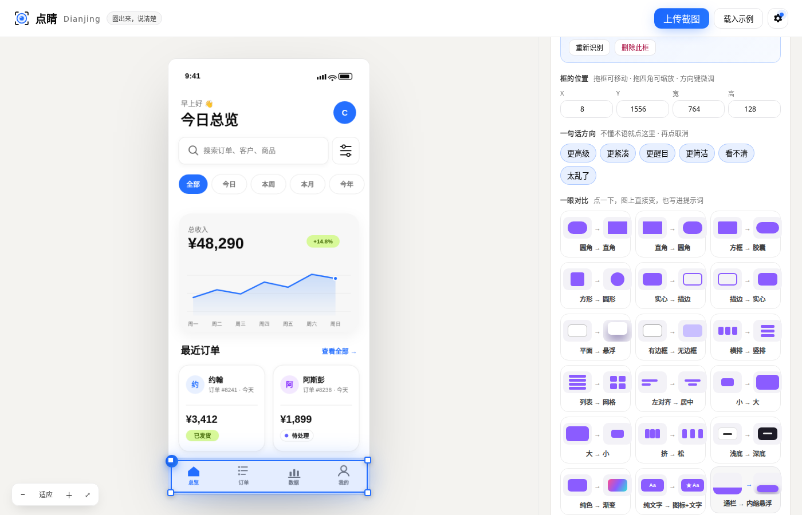

<div align="center">

# ◎ 点睛 Dianjing

**圈出来，说清楚。**

在任意界面截图上圈出想改的地方，点睛把你的感觉翻译成设计语言，给你「一眼对比」和三个方案预览，再生成一段 AI 编程工具一次就能听懂的提示词。

[**在线试用**](https://ttnan.github.io/dianjing/) · [English](README.en.md) · MIT 开源


🎬 [动效演示视频](docs/demo.mp4)

</div>

---

### 名字的由来

「画龙点睛」：一幅画最后点上眼睛，整条龙才活过来。AI 生成的界面往往八十分，剩下二十分就差那一下。点睛就是帮你点准那一下。

### 为什么做这个

已经有很多工具能帮 AI「定位」元素（React Grab、Agentation、stagewise、ComposeBridge……），但它们只解决了**改哪里**。真正卡住大多数人的是**改成什么**：你觉得底栏「很廉价」，却说不出「悬浮胶囊、大圆角、柔和投影、选中项实心高亮」。

| | 定位类工具 | 点睛 |
|---|---|---|
| 告诉 AI 改哪个元素 | ✅ | ✅ 截图坐标 + 语义位置 + 编号标注图 |
| 把模糊感受翻译成设计术语 | ❌ | ✅ 设计词典 + AI 识别推荐 |
| 不懂术语也能表达 | ❌ | ✅ 「一眼对比」图示，点一下就懂 |
| 改之前先看效果 | ❌ | ✅ 三个风格不同的方案即时预览 |
| 需要源码 / 特定框架 | 需要 | **不需要**：网页、安卓、iOS、小程序、设计稿截图都行 |

### 功能

1. **截图圈选**：上传、拖入或 ⌘/Ctrl + V 粘贴截图，按住拖拽圈出一处或多处，实时显示尺寸。圈好后拖框体移动、拖四角缩放、方向键微调、数字坐标精确改，Ctrl/⌘ + 滚轮放大看细节。
2. **一句话方向**：「更高级」「更紧凑」「太乱了」……不懂术语也能点，再点一次取消。
3. **一眼对比**：18 张「前 → 后」小图示，比如圆角 → 直角、实心 → 描边、横排 → 竖排、通栏 → 内缩悬浮，一看就懂，点一下就写进提示词。互斥方向（圆角 → 直角 vs 直角 → 圆角）选其一时自动取消相反项。
4. **设计词典**：7 大类 27 个词条（间距、层级、颜色、排版、质感、布局、风格），悬停看白话解释，默认收起、支持搜索。
5. **AI 识别**（可选）：自动认出「这是底部导航栏」，描述现状、指出问题、推荐修改方向。
6. **三个方案预览**（可选）：按你的意图生成三个可视化变体，选一个直接贴到原截图上，拖滑块擦除对比改前改后。
7. **框内文字**：填上框里的文字（如按钮文案），提示词里带上它，AI 在代码里找组件更准。
8. **输出**：中 / 英文提示词一键复制，文字 + 标注图也能一次复制；没提方向的空区域不写进提示词。
9. **自动保存**：圈选结果保存在浏览器里，刷新还在，随时可以「重新开始」清空。

不配置模型也能用 1–4 和 7–9；填入任意 **OpenAI 兼容的视觉模型**即可解锁 5、6，支持 OpenAI、通义千问、智谱 GLM、Gemini、OpenRouter、本地 Ollama。API Key 只保存在你自己的浏览器里，请求直接发往你选择的服务商，不经过任何第三方服务器。



### 快速开始

直接打开 **[在线试用](https://ttnan.github.io/dianjing/)**，点「先看看示例」。

本地运行（无需构建、无需安装依赖）：

```bash
git clone https://github.com/TTNAN/dianjing.git
cd dianjing
python3 -m http.server 8000   # 或 npx serve
# 打开 http://localhost:8000
```

> 由于使用了 ES Modules，请通过本地服务器打开，不要直接双击 `index.html`。

也可以一键部署到 GitHub Pages、Vercel、Netlify。

### 生成的提示词长什么样

```
# UI 修改请求
我在一张 780×1688px 的界面截图上标出了 1 处要改的地方（标注图已附上，编号与框对应）。只修改这些元素，其余保持不变，并优先复用项目里已有的设计变量和组件。

## 1. 底部导航栏 — 底部通栏
- 位置：x=4, y=1532, 宽 772, 高 152（截图像素）
- 现状：白色通栏底栏，灰色线性图标，选中项蓝色
- 期望修改：
  - 布局：贴边通栏改为四周留边距的悬浮条（左右 16px、底部 12px、大圆角、投影）
  - 提升质感：克制的配色、更多留白、更精细的字重层次、细腻的投影和圆角
- 我的原话：看起来很廉价，想要像苹果那样
- 选定方案：「悬浮胶囊」— 底栏浮起成胶囊，选中项实心高亮

动手前先根据文字和位置找到渲染每个元素的组件；改完后简要列出你改了哪些文件。
```

### 目录结构

```
index.html        页面骨架
favicon.svg       图标（16px 下的简化眼睛）
src/app.js        圈选、渲染、交互与动效
src/vocab.js      设计词典 + 一眼对比（最欢迎 PR 的地方）
src/prompt.js     提示词组装（中 / 英）
src/llm.js        OpenAI 兼容接口：识别 + 三方案
src/demo.js       内置示例界面（手机端数据看板）
src/styles.css    界面与动效
tests/e2e.py      Playwright 端到端测试与录屏（带断言，模型请求用假数据拦截）
tests/unit.test.mjs  单元测试：词典规模、互斥对、提示词组装
```

### 测试

```bash
node --test tests/unit.test.mjs   # 单元测试
python3 -m http.server 8766       # 端到端测试要先在仓库根目录起一个静态服务
python3 tests/e2e.py              # 需已安装 playwright + chromium
```

### 路线图

- [x] v0.1 截图圈选、设计词典、一眼对比、三方案预览、提示词输出
- [x] v0.2 方案贴回原图对比、框移动/缩放/微调、词典收起+搜索、框内文字、互斥自动取消、自动保存、文字+图一并复制
- [ ] 浏览器插件：在任意网页上直接圈选，不用截图
- [ ] MCP Server：让 Claude Code / Cursor 直接读取圈选结果
- [ ] 接入 React Grab、Agentation、ComposeBridge 等定位工具，补上源码位置
- [ ] 安卓：通过 adb 截屏 + 无障碍树，自动获取真机界面
- [ ] 词典与对比图扩充：动效、表单、数据可视化、无障碍
- [ ] 方案对比：两个方案并排、滑块对比

### 参与贡献

最有价值的贡献是扩充 `src/vocab.js`：

- **设计词典词条**：`hint`（白话解释）+ `prompt.zh` / `prompt.en`（精确说法）
- **一眼对比**：`before` / `after`（两段迷你 HTML 图示）+ `prompt`

欢迎提 Issue 和 PR。

### 许可

[MIT](LICENSE) © 2026 Caesar T
