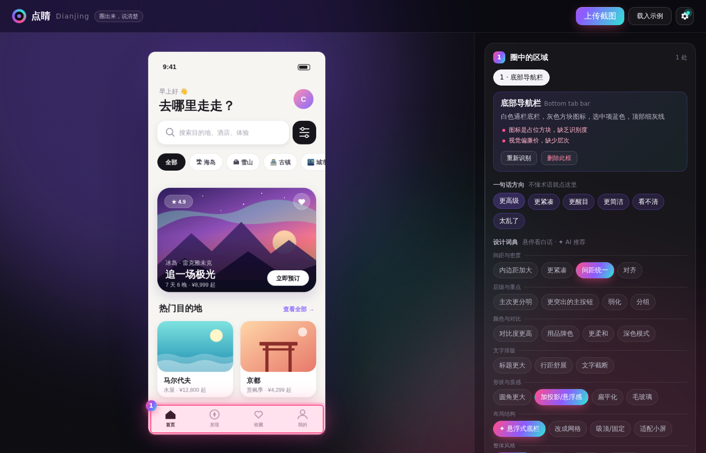

# ◎ 点睛 Dianjing — 圈出来，说清楚

> 画龙点睛：在界面上圈一下，让 AI 改到点子上。



🎬 [动效演示视频](docs/demo.mp4) · 当前版本 **v0.1**

> 用 AI 做出来的网页 / App，总有地方想改，却不知道怎么说？
> 在截图上**圈出来**，点睛把你的感觉**翻译成设计语言**，给你**三个方案预览**，再生成一段 AI 编程工具一次就能听懂的**提示词**。

[English](#english) · MIT License · 纯前端、零构建、无需后端

## 为什么做这个

已经有很多工具能帮 AI「定位」元素（React Grab、Agentation、stagewise、ComposeBridge……），但它们只解决了 **"改哪里"**。
真正卡住大多数人的是 **"改成什么"**：你觉得底栏"很廉价"，但说不出"悬浮胶囊、大圆角、柔和投影、选中项实心高亮"。

点睛专注这一层：

| | 定位工具（已有） | 点睛 |
|---|---|---|
| 告诉 AI 改哪个元素 | ✅ | ✅（截图坐标 + 语义位置 + 标注图） |
| 把模糊感受翻译成设计术语 | ❌ | ✅ 内置设计词典 + AI 识别推荐 |
| 改之前先看效果 | ❌ | ✅ 三个风格不同的方案即时预览 |
| 需要源码 / 特定框架 | 需要 | **不需要**，任何截图都行（网页、安卓、iOS、设计稿） |

## 功能

1. **截图圈选**：上传、拖入或 Ctrl/⌘+V 粘贴截图，拖拽圈出一处或多处。
2. **一句话方向**：不懂术语也能点——「更高级」「更紧凑」「太乱了」……
3. **设计词典**：7 大类 27 个词条（间距、层级、颜色、排版、质感、布局、风格），悬停看白话解释，点选即写入提示词。
4. **AI 识别**（可选）：自动认出"这是底部导航栏"，描述现状、指出问题、推荐词条。
5. **三个方案预览**（可选）：按你的意图生成 3 个可视化变体，选一个写入提示词。
6. **输出**：中 / 英文提示词一键复制 + 带编号的标注图下载，粘贴给 Cursor、Claude Code、Trae、Codex、Lovable、v0、Bolt 等。

不填模型也能用 1、2、3、6；填入任意 **OpenAI 兼容的视觉模型**解锁 4、5：OpenAI、通义千问、智谱 GLM、Gemini、OpenRouter、本地 Ollama 均可。API Key 只保存在你自己的浏览器里，请求直接发往你选的服务商。

## 快速开始

```bash
git clone https://github.com/TTNAN/dianjing.git && cd dianjing
python3 -m http.server 8000   # 或 npx serve
# 打开 http://localhost:8000 ，点「载入示例」试一下
```

也可以直接部署到 GitHub Pages / Vercel / Netlify，无需构建。

## 目录结构

```
index.html        页面骨架
src/app.js        圈选、渲染、交互
src/vocab.js      设计词典（最欢迎 PR 的地方）
src/prompt.js     提示词组装（中/英）
src/llm.js        OpenAI 兼容接口：识别 + 多方案
src/demo.js       内置示例界面
src/styles.css    样式
```

## 路线图

- [x] v0.1 截图圈选 + 设计词典 + 三方案预览 + 提示词输出
- [ ] 浏览器插件：在任意网页上直接圈选（不用截图）
- [ ] MCP Server：让 Claude Code / Cursor 直接读取圈选结果
- [ ] 接入 React Grab / Agentation / ComposeBridge 等定位工具，补上源码位置
- [ ] 安卓：通过 adb 截屏 + 无障碍树，自动获取真机界面
- [ ] 词典扩充：动效、表单、数据可视化、无障碍；社区贡献词条
- [ ] 方案对比：两个方案并排、滑块对比

## 贡献

最有价值的贡献是 **扩充 `src/vocab.js` 设计词典**：每个词条包含白话解释（hint）和精确的提示词说法（prompt.zh / prompt.en）。

---

## English

**Dianjing (点睛, "dotting the dragon's eye" — the finishing touch that brings a picture to life)** — circle what bugs you on any UI screenshot, get it translated into precise design language, preview three variations, and copy a prompt your AI coding tool understands on the first try. Zero build, no backend, bring your own OpenAI-compatible vision model (optional). MIT.
